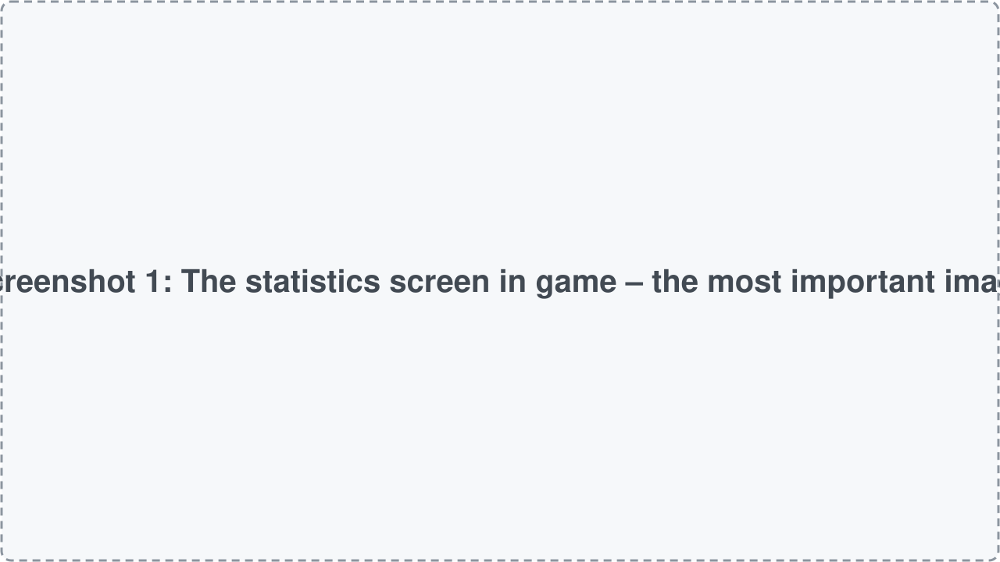
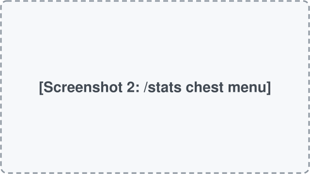
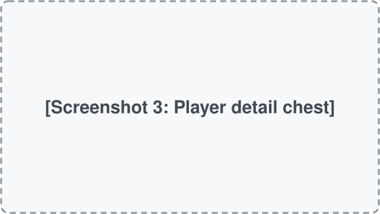

> [!NOTE]
> You are viewing the branch for **Minecraft 26.2**. The latest version lives in the [26.3](https://github.com/Mikeflavour/Mikes_Stats/tree/26.3) branch.

# Mike's Stats

**See the statistics of every player on your server – in a chest menu for everyone, or a full statistics screen with the client mod.**

[Latest version (26.3)](https://github.com/Mikeflavour/Mikes_Stats/releases/tag/mc26.3-0.1.0) ·
[Minecraft 26.2](https://github.com/Mikeflavour/Mikes_Stats/releases/tag/mc26.2-0.1.0) ·
[Rust version](#versions) ·
[Report a bug](https://github.com/Mikeflavour/Mikes_Stats/issues/new/choose)

<!-- Placeholder images: replace with real screenshots/GIFs in docs/images/ later -->

  

  
  

## What does it do?

Vanilla only shows your own statistics. Mike's Stats shows the statistics of **every player who ever joined the server**, online or offline, side by side.

- **`/stats` chest menu** – works for every player, even without the mod installed on their game. One player head per player, click a head for details.
- **Statistics screen** – with the client mod, an **All statistics** button in the pause menu opens a table with tabs: Overview, General, Mobs, Blocks, Items, Travel and Deaths. Click any column to sort.
- **Extra stats since install** – highest level, total XP, PvP victims and a death log with cause and level.

## Versions

Pick your Minecraft version. **Download** takes you straight to the right file, **Code** to the branch for that version.

<b>26.x</b> · current

| Minecraft | Mod version | Loader | Status | |
|---|---|---|---|---|
| **26.3** | 0.1.0 | Fabric | 🟢 Latest | [Download](https://github.com/Mikeflavour/Mikes_Stats/releases/tag/mc26.3-0.1.0) · [Code](https://github.com/Mikeflavour/Mikes_Stats/tree/26.3) |
| **26.2** | 0.1.0 | Fabric | 🔵 Supported | [Download](https://github.com/Mikeflavour/Mikes_Stats/releases/tag/mc26.2-0.1.0) · [Code](https://github.com/Mikeflavour/Mikes_Stats/tree/26.2) |

<b>Rust version</b> · planned

The Rust version is planned and will get its own `rust` branch in this repository.

## Installation

1. Install [Fabric](https://fabricmc.net/use/) and [Fabric API](https://modrinth.com/mod/fabric-api) for your Minecraft version.
2. Download the file for your version from [Releases](https://github.com/Mikeflavour/Mikes_Stats/releases), e.g. `Mikes_Stats-0.1.0+26.3.jar`.
3. Put the file into the `mods` folder of your server. Players who want the statistics screen also put it into their `.minecraft/mods` folder.

## FAQ

<b>Do I need it on the server?</b>

Yes. The server collects the statistics. Players don't need the mod: everyone can use `/stats`. The client mod only adds the statistics screen.

<b>Which file do I need?</b>

The one with your Minecraft version in its name, e.g. `Mikes_Stats-0.1.0+26.3.jar` for Minecraft 26.3.

<b>Why are some numbers only "since mod"?</b>

Vanilla doesn't save things like your highest level or who killed whom. The mod starts counting these when it is installed.

<b>Does it work with other mods?</b>

No incompatibilities have been found with this version so far. If you run into one, please [open an issue](https://github.com/Mikeflavour/Mikes_Stats/issues/new/choose) – any info is very welcome!

<b>What is the Rust version?</b>

The Rust version is being built for **Horizon**, a project that needs these mods written in Rust.
It will live in the `rust` branch of this repository.

## Repository layout

What is each folder for? (for contributors)

| Path | Purpose |
|---|---|
| `.github/` | Issue templates and automation (build on every push, attach the `.jar` to every release) |
| `src/` | The mod's code and resources |
| `docs/images/` | Images used in this README |
| `gradle.properties` | Mod version and Minecraft version – change them only here |
| `CHANGELOG.md` | What changed in each version |

Every Minecraft version has its own branch (`26.3`, `26.2`, …). The default branch is always the latest version.

## Help & bug reports

Something not working? Open an [issue](https://github.com/Mikeflavour/Mikes_Stats/issues/new/choose) and pick the matching template.

## Credits & license

Made by Mikeflavour.

All rights reserved.
